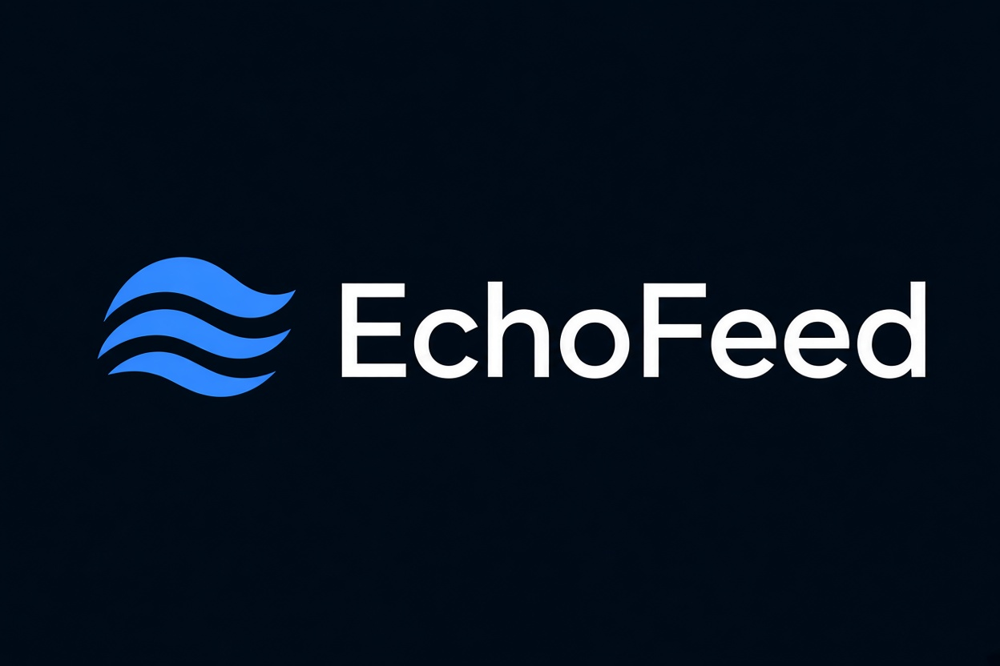
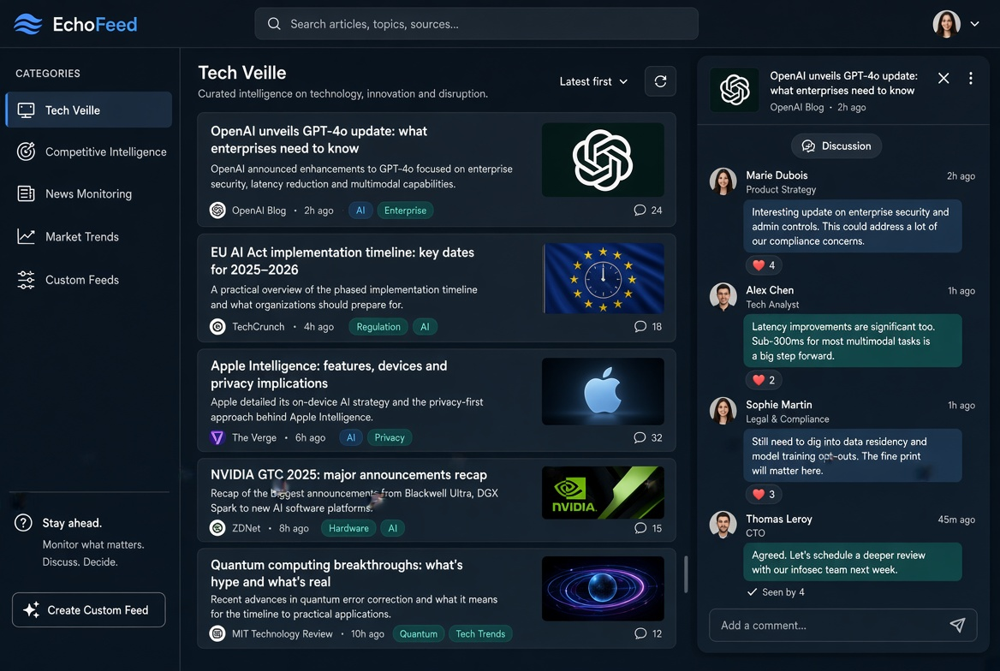

<p align="center"></p>

# EchoFeed — Veille technologique en temps réel

EchoFeed est une application web de veille technologique et thématique. Elle agrège des flux RSS, classe les articles par niveau d'importance, et permet d'en discuter en direct avec d'autres utilisateurs.



## Fonctionnalités

- **Veille par catégories** : Technologie, Sport, Politique, Santé, Finance, Nature. Chaque utilisateur choisit ses catégories dans son profil.
- **Niveaux d'importance** : chaque article est classé *basse*, *moyenne* ou *importante* (score à base de mots-clés pondérés), avec un son d'alerte par niveau.
- **Top 10 de la semaine** (publié le dimanche à 18 h), **Daily News** (chaque matin à 8 h) et **alertes** en temps réel.
- **Chat en temps réel** (Socket.io) : un salon « Général » et un salon par catégorie choisie, avec partage d'articles dans la conversation.
- **QuackBot** : assistant virtuel (Daily News, Alertes, Top 10, guide interactif, sons).
- **Comptes** : inscription / connexion, système d'invitation, espace administrateur.
- **RGPD** : bandeau de consentement aux cookies.

## Architecture

| Couche | Technologies |
|---|---|
| Front-end | HTML5, CSS3, JavaScript natif |
| Back-end | Node.js, Express |
| Temps réel | Socket.io (WebSocket) |
| Veille | `feedparser`, `request` |
| Persistance | Fichier JSON (`data/db.json`) |
| Sécurité | HTTPS, bcrypt, JWT, messages chiffrés (AES) |

## Structure du dépôt

```
.
├── server.js              # Serveur Express + Socket.io (comptes, chat, administration)
├── package.json
├── .env.example           # Modèle de configuration (à copier en .env)
├── veille/                # Outil de veille (flux RSS, scoring, alertes, Top 10)
│   ├── config.js          #   catégories, flux, mots-clés, seuils : le fichier à modifier
│   └── ...                #   voir veille/README.md
├── public/                # Interface web servie par le serveur
│   ├── index.html
│   ├── css/style.css
│   ├── js/app.js
│   ├── images/guide/      #   illustrations du guide interactif
│   └── sound/             #   sons de QuackBot, du chat et des alertes (.m4a)
├── data/                  # Base JSON créée au premier lancement (non versionnée)
├── scripts/
│   └── generate-cert.sh   # Génère le certificat HTTPS auto-signé
└── docs/images/           # Logo et prototype
```

## Démarrage rapide

Prérequis : [Node.js](https://nodejs.org) 18 ou plus, et OpenSSL (pour le certificat).

```bash
npm install
npm run cert                  # crée key.pem et cert.pem
cp .env.example .env          # puis éditez les secrets et le mot de passe root
npm start
```

Ouvrez ensuite **https://localhost:8443** (le navigateur signale un certificat auto-signé : acceptez l'exception).

Un compte administrateur `root` est créé au premier lancement, avec le mot de passe défini par `ROOT_PASSWORD` dans le `.env` (à renseigner avant le premier démarrage ; sans cela, le mot de passe par défaut est `root`).

## API de veille

Les résultats suivent les catégories choisies dans le profil de l'utilisateur connecté (ou `?category=`).

| Route | Description |
|---|---|
| `GET /api/articles` | Actualités |
| `GET /api/articles/top10` | Top 10 de la semaine |
| `GET /api/articles/daily` | Daily News (dernières 24 h) |
| `GET /api/articles/alertes` | Alertes (les plus importants des dernières 24 h) |

## Auteurs

- BLARD Samuel — Gestionnaire BDD / Back-End
- DOUCE Lucas — Gestionnaire Front-End / UI
